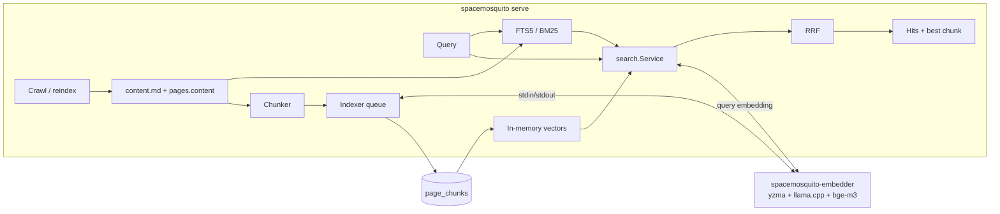

# Semantic search with embedded llama.cpp + bge-m3

- **Task ID:** `semantic-search`
- **Status:** in_progress
- **Parent / blocked by:** [issue #9](https://github.com/infomosquitos/spacemosquito/issues/9); [ADR-019](../../docs/adr/019-semantic-search-embeddings.md)
- **Target release:** v0.9.0

## Problem

Search everywhere (MCP `confluence_search`, REST `/api/search`, browse, CLI) is FTS5 + BM25 with AND semantics. It finds exact terms, IDs and titles, but misses pages that answer a question in other words ("how do we handle price updates from SAP" → "ZCONDA -> PriceRow Import"). The `embedder` config section exists, but nothing reads it.

## Goal

Out of the box (Homebrew install, no extra setup), `serve` embeds every saved page with bge-m3 running in-process via llama.cpp, and search defaults to **hybrid** (BM25 + vectors, RRF). Exact keyword and title hits stay on top; meaning-based hits fill the gaps. `embedder.provider: none` turns it off.

## Open questions

| # | Topic | Status | Decision |
|---|--------|--------|----------|
| 1 | Runtime | locked | llama.cpp loaded at runtime via [yzma](https://github.com/hybridgroup/yzma) (purego/ffi, no CGO), in a helper process (see spike). |
| 2 | Model | locked | bge-m3, GGUF Q8_0 from `ggml-org/bge-m3-Q8_0-GGUF` (sha256 `aa473d51…a173`, 634,553,760 B). |
| 3 | Shipping | locked | Pre-packaged: llama.cpp libs inside the `spacemosquito` cask archive; the model file is a release asset of this repo (`model-bge-m3-q8_0-v1`, Actions → Model release), downloaded once by the cask via `spacemosquito model install` (0.9.0's separate model cask was dropped in 0.9.1: Homebrew 7 trust). No runtime downloads by serve. |
| 4 | Default | locked | On: background backfill in `serve`; `hybrid` is the default search mode. |
| 5 | Evaluation set | open | ~30 real questions + answer pages from the user's catalog, kept outside the repo. Needed before ADR-019 is Accepted, not before v0.9.0 code. |

## Spike results (2026-11-12, M-series Mac, yzma v1.32.0, llama.cpp b12110)

- `CGO_ENABLED=0` builds pass for darwin/arm64, darwin/amd64, linux/amd64 and windows/amd64.
- bge-m3 loads (`bert 335M Q8_0`, 1024 dims, CLS pooling from GGUF metadata) in about 5 s.
- **Sanity:** for the query "price updates from SAP", the related EN text scores 0.57 and the DE text 0.68; unrelated texts score 0.43 and 0.47.
- **Consistency:** results are deterministic, and batched vs single embeddings are identical (dot = 1.000000).
- **Throughput:**

  | Backend | tok/s | chunks/s (~480 tokens each) |
  |---|---|---|
  | Metal | ~3,200 | 6.5–7 |
  | CPU | ~1,100 | 2.3 |

  Batch shape (1k–8k tokens, 1–16 sequences) makes no difference. A single query takes about 15 ms.
- **Catalog estimate:** the 956 pages are 4.07 MB of Markdown, about 1.2M tokens. A full backfill takes roughly 7 min on Metal and 20 min on CPU; later only changed pages are embedded.
- **libffi:** `jupiterrider/ffi` (a yzma dependency) loads libffi in `init()` and **panics if it is missing**. macOS and Windows use an embedded copy, extracted to the user cache dir. Linux needs `libffi.so.8`. This is why the llama code must not be linked into the main binary.
- **Libs needed per platform:** `ggml`, `ggml-base`, `ggml-cpu*`, `ggml-metal`/`ggml-blas` (macOS), and `llama`. That is about 11 MB on macOS arm64. Upstream assets:

  | Platform | Asset |
  |---|---|
  | macOS arm64 | `llama-b12110-bin-macos-arm64.tar.gz` |
  | macOS x64 | `…-macos-x64.tar.gz` |
  | Linux x64 | `…-ubuntu-x64.tar.gz` |
  | Windows x64 | `…-win-cpu-x64.zip` |

  The SHA256s come from yzma's pinned manifest.

## Non-goals

- Remote/OpenAI-compatible providers and Ollama. The `Embedder` interface allows them later.
- `sqlite-vec` or any SQLite extension.
- Attachment text chunks (#7), table-cell quality (#6), a `confluence_related` tool, and re-ranking.

## Design



### Helper process `spacemosquito-embedder` (`cmd/spacemosquito-embedder`)

- A separate binary built from the same module; only it imports yzma. A `go list -deps ./cmd/spacemosquito` check (test) guarantees the main binary never links yzma or ffi.
- Protocol: length-prefixed JSON frames on stdin/stdout. Request `{id, texts[]}`, response `{id, vectors (base64 float32 LE), error}`. A `hello` reply returns model description, dims and pooling.
- `serve` starts it lazily and sets `LD_LIBRARY_PATH` (Linux) or the lib dir argument, then restarts it on crash with backoff. It stops the helper after 10 idle minutes to free RAM; the next query or indexing job starts it again.
- Settings: model `NGpuLayers` = all (Metal) or 0, `NCtx` = 2048, one sequence per text, and texts truncated to 2048 tokens.

### Lookup of helper, libs and model (`internal/embed/locate.go`)

1. config `embedder.helper_path` / `lib_path` / `model_path`
2. next to the resolved executable (`os.Executable` + `EvalSymlinks`): `spacemosquito-embedder`, `lib/`
3. the model in `<prefix>/share/spacemosquito/models/bge-m3-q8_0.gguf`, where `<prefix>` is derived from `<prefix>/bin/spacemosquito`, or in the `$HOMEBREW_PREFIX` equivalent
4. `~/.spacemosquito/{lib,models}`

If something is missing, `serve` logs one clear line and keyword search continues.

### Chunker (`internal/embed/chunk.go`)

- Split `content.md` by Markdown headings and track the heading path.
- Target about 350 tokens (approximated as 3.3 chars/token, measured on this catalog). Overlap between pieces of one long section is about 40 tokens.
- Fenced code blocks and tables are never split. An oversized block becomes its own chunk, and the helper truncates it.
- The embedded text is `"<title>\n<heading path>\n\n<chunk>"`.
- `content_hash` = sha256(embedded text).

### Storage (migration `014_page_chunks`)

```sql
CREATE TABLE page_chunks (
  page_id      TEXT    NOT NULL REFERENCES pages(id) ON DELETE CASCADE,
  chunk_index  INTEGER NOT NULL,
  heading_path TEXT    NOT NULL DEFAULT '',
  text         TEXT    NOT NULL,
  content_hash TEXT    NOT NULL,
  model        TEXT    NOT NULL,
  dims         INTEGER NOT NULL,
  vector       BLOB    NOT NULL,
  PRIMARY KEY (page_id, chunk_index)
);
CREATE INDEX page_chunks_model ON page_chunks(model);
```

### Indexer (`internal/embed/indexer.go`)

- `IndexPage` chunks the page, compares hashes with what is stored, embeds only changed chunks and replaces the page's rows in one transaction.
- Triggers:
  - `serve` start: backfill pages whose chunks are missing or stale (another model).
  - After each saved page: a crawl job (`internal/scraper/job.go`) or a cron run notifies the queue (non-blocking).
- `spacemosquito reindex --embeddings [--space KEY]` runs the same code in the foreground, with progress.
- Progress is exposed in `GET /api/stats` and `spacemosquito status`.

### Search (`internal/search/service.go`, `hybrid.go`)

- The vector index keeps all chunk vectors of the current model in one `[]float32` matrix, loaded lazily and reloaded when a generation counter changes after chunk writes.
- Semantic search: embed the query, compute brute-force dot products, keep the best chunk per page.
- Hybrid search:
  1. Take BM25 top 50 and vector top 50.
  2. Merge with RRF (k = 60).
  3. Use the best chunk plus its heading path as the excerpt when the page came from the vector side, otherwise the FTS snippet.
- `mode`: `keyword` | `semantic` | `hybrid`. The default is `hybrid` when vectors exist, otherwise `keyword`. Results include `mode_used`.
- MCP `toolSearch`, REST `/api/search` and CLI `search` all go through `search.Service`; browse uses REST.

### Packaging

- Release archives `spacemosquito-<os>-<arch>.tar.gz` (`.zip` on Windows), each containing:
  - `spacemosquito`
  - `spacemosquito-embedder`
  - `lib/` (plus `libffi.so.8` on Linux)
  - `THIRD_PARTY_LICENSES`
- `scripts/fetch-llama-libs.sh` downloads the pinned upstream asset, checks its sha256 and copies the needed libs.
- Main cask: the url points to the archive, `binary "spacemosquito"`, a guarded postflight step running `spacemosquito model install`, and quarantine removal for the whole staged dir.
- Model cask: published by the manual workflow `model-release.yml` (release tag `model-bge-m3-q8_0-v1`), with `artifact` → `#{HOMEBREW_PREFIX}/share/spacemosquito/models/bge-m3-q8_0.gguf`.

## Slices (each keeps `go test ./...` green)

1. **Helper:** `cmd/spacemosquito-embedder` + `internal/embed/protocol` + client with a fake helper in tests; locate logic.
2. **Chunker:** with table-driven tests.
3. **Storage:** migration 014 + store methods + tests (cascade on page/space delete).
4. **Indexer:** queue, backfill in `serve`, crawl hooks, `reindex --embeddings`, stats.
5. **Search:** `search.Service` (vector index, RRF, modes) + MCP/REST/CLI wiring + tests.
6. **Packaging:** fetch script, archives, cask renderers, model workflow, release workflow.
7. **Docs:** ADR-019, README, INSTALL, `dev/README.md` search section, CHANGELOG, `config.yaml.example`.
8. **Evaluation:** `eval-search` dev command; run it on the user's question set and record the result in ADR-019.

## Progress

Slices 1–7 done (2026-11-12). Full backfill of the 956-page catalog (copy): 5,223 chunks in 9 min 23 s on Metal, 0 failures; a rerun with nothing changed takes 0.45 s. Hybrid search finds paraphrased and German questions that keyword search misses (e.g. "how is the cart recalculated when prices are outdated": keyword 0 results, hybrid → the order simulation pages). `eval-search` is ready; a 3-question smoke run showed hybrid MRR 0.75 vs semantic 1.00 (keyword noise demoting a good semantic hit), which is a candidate for RRF tuning once the real set exists.

## Done when

- [ ] Fresh Homebrew install (both casks) → `serve` backfills → hybrid search finds paraphrased questions that keyword search misses.
- [ ] `embedder.provider: none` → no helper process, results identical to v0.8.10.
- [ ] Main binary does not link yzma/ffi (test).
- [ ] Missing helper, libs or model, or a helper crash → keyword search keeps working and crawls never fail.
- [ ] MCP and REST expose `mode`; hits carry chunk excerpts with heading paths.
- [ ] Tests: protocol/client, chunker, store, incremental indexing, RRF/vector ranking.
- [ ] Docs updated; ADR-019 records the evaluation; released as v0.9.0.
