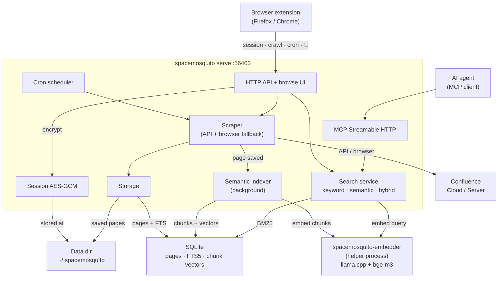
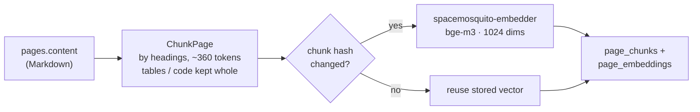
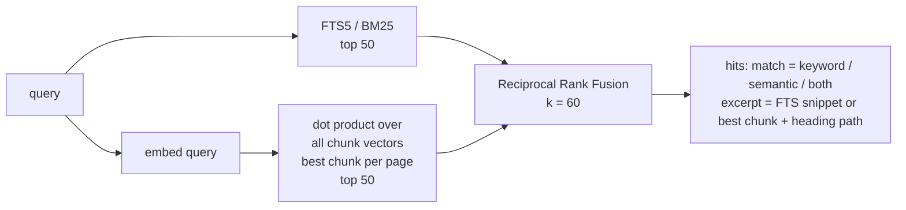

# SpaceMosquito Architecture

SpaceMosquito is a Confluence space scraper, indexer and search engine with
automated cron scheduling. It uses the Confluence REST API for content
extraction (with headless browser fallback), stores pages locally as Markdown
in **SQLite + FTS5**, and searches them **by keyword and by meaning**: pages
are embedded locally with the multilingual **bge-m3** model through
**llama.cpp**, and hybrid search merges BM25 with vector similarity. It
exposes an MCP server for LLM integration, a browse UI, and Firefox/Chrome
extensions for session management and crawl control.

Docker / PostgreSQL are not part of the runtime. See [ADR-016](adr/016-sqlite-only-distribution.md).
Semantic search: [ADR-019](adr/019-semantic-search-embeddings.md).

## System Components



## Entry Points

### `cmd/spacemosquito`

Primary CLI + server binary: `init`, `serve`, `crawl`, `search`, `get-page`,
`reindex` (`--content`, `--embeddings`), `stats`, `eval-search`,
`export-html`, `delete-space`, bootstrap, cron helpers. It never links
native code (enforced by a test).

### `cmd/spacemosquito-embedder`

Helper started by `serve` (and by `search`/`reindex --embeddings` in the CLI).
It loads the llama.cpp shared libraries at runtime through
[yzma](https://github.com/hybridgroup/yzma) (purego, no CGO) plus the GGUF
model, and answers embedding requests on stdin/stdout. Native code runs only
here: a crash cannot take `serve` down, and Linux machines without libffi
still run every other command.

### `cmd/server` / `cmd/cli`

Thin aliases kept for compatibility; prefer `cmd/spacemosquito`.

## Internal Packages

| Package | Responsibility |
|---------|----------------|
| `api` | HTTP handlers — session, search, crawl, cron, spaces, pages |
| `app` | `serve` wiring — config, DB, storage, session, search, semantic indexer |
| `browse` | Browse UI rendered on request from `content.md` (ADR-018); `export-html` |
| `catalogindex` | Page tree from the DB; `index.md` navigation files |
| `config` | YAML config loading with JSON per-space cron overrides |
| `contentmd` | Storage Format / HTML → Markdown for `pages.content` / `content.md` |
| `cron` | gocron/v2 scheduler — full/incremental crawl jobs |
| `datastore` | Open/migrate SQLite |
| `embed` | Chunker, helper protocol and process client, file lookup, indexer, background runner (ADR-019) |
| `embed/llamacpp` | llama.cpp backend of the helper (yzma); imported only by `cmd/spacemosquito-embedder` |
| `mcp` | MCP Streamable HTTP — JSON-RPC tools for search, pages, spaces |
| `paths` | Data-dir resolvers (`~/.spacemosquito`, env, `--data-dir`) |
| `scraper` | Confluence REST API (primary) + go-rod browser (fallback) |
| `search` | Search service (keyword, semantic, hybrid with RRF), in-memory vector index, DTOs, excerpts, evaluation |
| `session` | Cookie capture/management, Cloud vs Server flavor detection |
| `storage` | File system — Markdown, raw HTML, assets, metadata per space/page |
| `store` / `store/sqlite` | Store interface + models; SQLite + FTS5 + chunk storage |

## Data Flow

### Session Capture

```
Browser (Confluence page)
  → cookies.getAll() (extension background)
  → POST /api/session
  → AES-256-GCM encryption
  → session.enc under the data directory
```

- Flavor auto-detected during validation (Cloud vs Server/DC)
- Flavor stored in session, used for API URL construction

### Crawl Job

```
Extension / CLI / cron
  → crawl job manager
  → discoverSpace() (API first, browser sidebar fallback)
  → for each page: ScrapePageAPI() or ScrapePage() fallback
  → Storage Format → Markdown via contentmd
  → UpsertPage() into SQLite + FTS5; files under saved/{space}/{page}/
  → notify the semantic indexer
```

### Semantic Indexing



- `serve` runs a backfill at start, a few seconds after crawl page saves, and
  every minute; a pass over an unchanged catalog only hashes its text.
- A page is re-chunked when the hash of its title + content or the model
  changes; only chunks whose text changed are embedded again.
- The helper starts on demand, is restarted after crashes (with backoff),
  stops after 10 idle minutes and exits when `serve` does (stdin EOF).
- If the helper, libraries or model are missing, search stays keyword-only
  and crawls are unaffected.

### Search



- `mode`: `hybrid` (default when vectors exist), `keyword`, `semantic`; falls
  back to `keyword` when semantic search is unavailable.
- Keyword: AND for multi-word queries, BM25 with 10× title weight, title
  substring fallback when FTS finds nothing.
- Vectors of the current model live in memory (~20 MB per 1,000 pages) and
  are reloaded after the indexer writes.
- One `search.Service` serves MCP `confluence_search`, REST `/api/search`
  (and the browse search bars) and `spacemosquito search`.

## Database Schema (logical)

**spaces** — tracked Confluence spaces (`key`, `name`, `url`, `last_crawled`, …)

**pages** — crawled pages (`confluence_id`, `title`, `content` Markdown, paths, Confluence history, …)

**pages_fts** — FTS5 virtual table over title + content

**page_chunks** — per page: `chunk_index`, `heading_path`, `text`, `content_hash`, `vector` (float32)

**page_embeddings** — per page: `model` and `source_hash` the chunks were built from

**folders**, **users** — Confluence folders of the page tree; display names for @-mentions

Migrations live in `spacemosquito/migrations/sqlite/` (also embedded in release builds).

## Scraping Modes

1. **Confluence REST API** (default) — Cloud and Server/DC URL shapes
2. **Headless browser** (fallback) — go-rod / Chromium on demand when API fails

## Security

- Session: AES-256-GCM, 32-byte key from `config.yaml`, file mode `0600`
- Cookies: captured via browser cookies API; SameSite=None for Atlassian
- HTTP API: no auth — intended for local use (binds `127.0.0.1`)
- Embeddings are computed locally; page text never leaves the machine

## Technology Decisions

### SQLite + FTS5 + in-memory vectors

- Single-binary distribution; no separate database service
- FTS5 with Porter stemming; BM25 ranking with title weighting
- Chunk vectors stored as BLOBs and searched by brute force in Go — no SQLite
  extension needed at catalog scale (thousands of chunks)

### Local embeddings (llama.cpp + bge-m3)

- Multilingual model (German and English pages, questions in either)
- llama.cpp loaded at runtime without CGO, so release builds stay
  cross-compiled static Go binaries; Metal on Apple Silicon, CPU elsewhere
- Pinned upstream llama.cpp build per platform, shipped in the release archive

### Dual-mode scraper (API + browser)

- REST API is primary; go-rod only on failure / discovery fallback
- Browser launched on demand, not at every server start

### File-based session storage

- Simple and portable under the data directory

## Deployment

Release archives per platform hold `spacemosquito`, `spacemosquito-embedder`
and `lib/` (llama.cpp). On macOS the Homebrew cask installs them and depends
on `spacemosquito-bge-m3-embeddings-model`, which puts the model (635 MB, a
release asset of this repository) into `$(brew --prefix)/share/spacemosquito/models`.
See [INSTALL](INSTALL.md).

Data directory layout:

| Path | Purpose |
|------|---------|
| `config.yaml` | Runtime config |
| `spacemosquito.db` | SQLite database (pages, FTS, chunk vectors) |
| `session.enc` | Encrypted cookies |
| `saved/` | Crawled pages + assets |
| `logs/serve.log` | `serve` log (rotated) |
| `browser/` | Optional rod Chromium cache |
| `cron-config.json` | Per-space cron overrides |
| `models/`, `lib/` | Optional model / llama.cpp location for non-Homebrew installs |

Extensions run on the host and talk to `http://localhost:56403`.

## Known Limitations

1. No API auth — local use only
2. Session expiry — cookies expire; must re-capture
3. Confluence CSP blocks content-script injection
4. In-memory crawl jobs — not persisted across restarts
5. Single browser instance per job for fallback scrapes
6. The first semantic indexing takes minutes (about 10 per 1,000 pages on an
   M-series Mac, longer on CPU); until then, pages not yet embedded are
   found by keyword only
7. Attachment text is not searched yet ([#7](https://github.com/infomosquitos/spacemosquito/issues/7))
